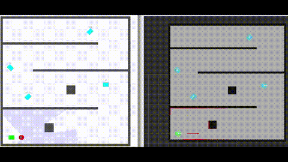
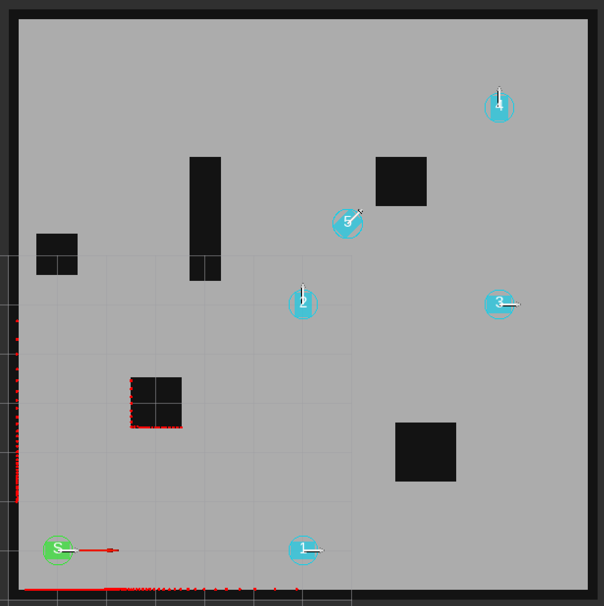
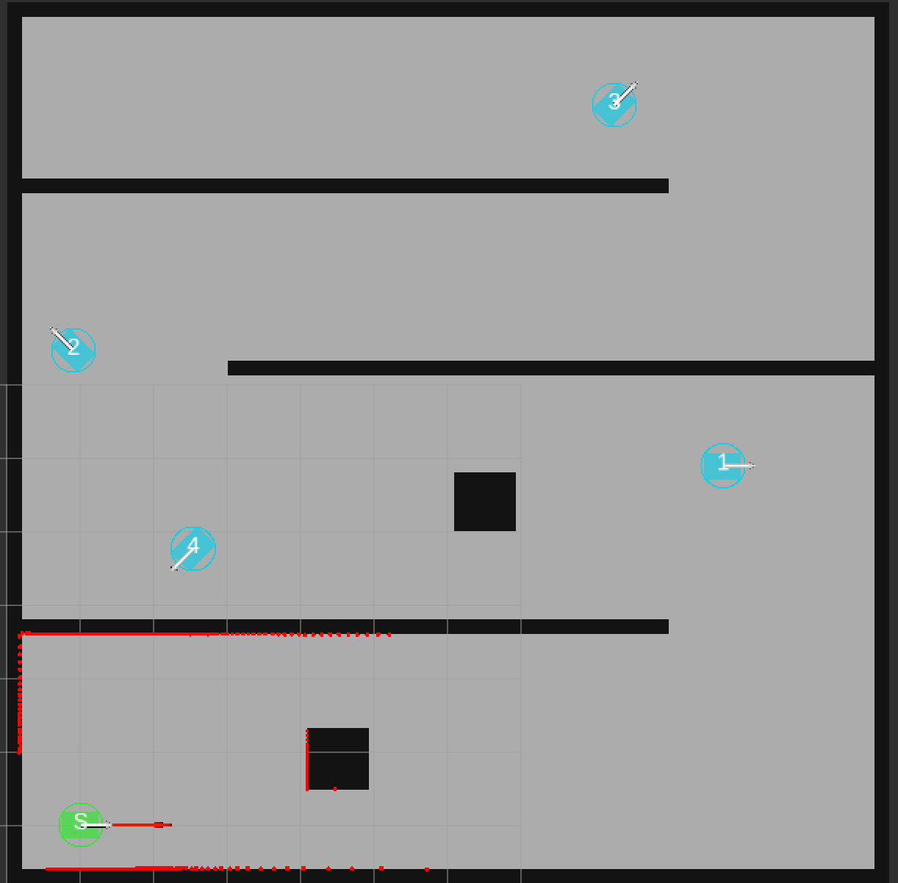
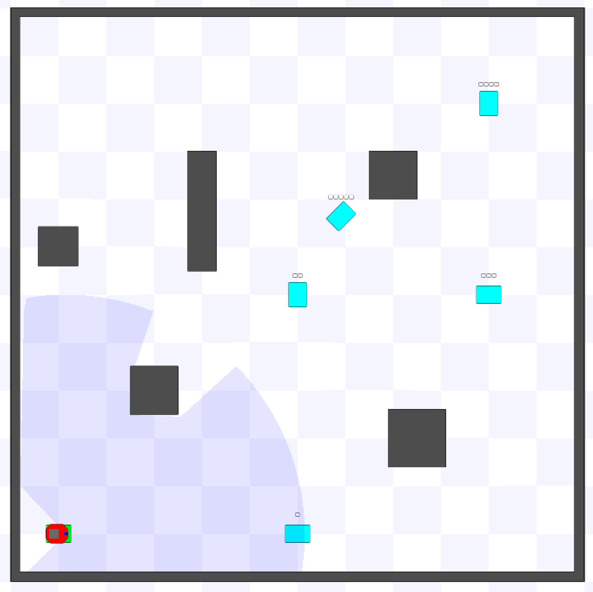
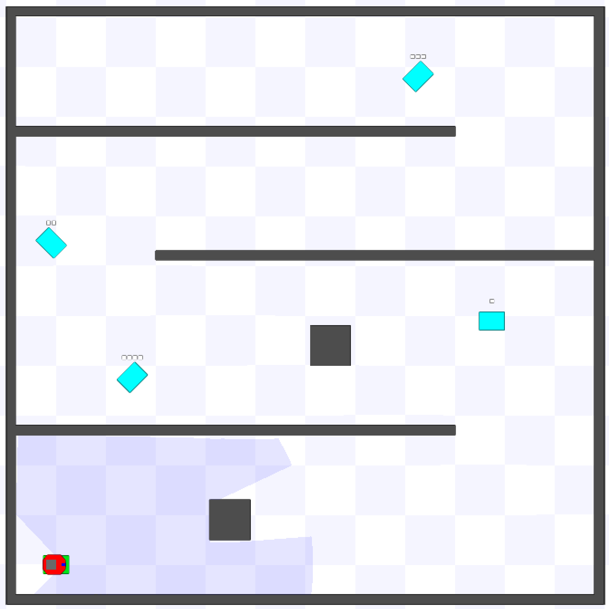

# CodeRun 2026 - Path Planning Challenge

Navigate a differential-drive robot through an arena to reach goal poses in order, as fast as possible.



## Preliminaries

### Windows (WSL)

```bash
wsl --install -d Ubuntu-22.04
```

Inside WSL, install Docker Engine:
```bash
sudo apt update && sudo apt install -y docker.io x11-xserver-utils
```

```bash
sudo usermod -aG docker $USER
```

Log out and back in (or `newgrp docker`).

### Ubuntu (native)

```bash
sudo apt update && sudo apt install -y docker.io x11-xserver-utils
```

```bash
sudo usermod -aG docker $USER
```

Log out and back in.

## Quick Start

```bash
docker pull laurentiupopa/coderun-ros2-wander:latest
```

```bash
xhost +local:root
```

```bash
export ROS_DOMAIN_ID=1
```

```bash
docker run -it --name coderun --privileged --network=host -e DISPLAY=$DISPLAY -e ROS_DOMAIN_ID=$ROS_DOMAIN_ID -v /tmp/.X11-unix:/tmp/.X11-unix:ro -w /root/ros_ws laurentiupopa/coderun-ros2-wander:latest bash
```

## Running the Challenge

**Terminal 1** — Arena + Judge:
```bash
ros2 launch coderun_challenge challenge.launch.py task:=easy team:=MyTeam
```

**Terminal 2** — Open new terminal in container:
```bash
docker exec -it coderun bash
```

Run your solution:
```bash
python3 ~/ros_ws/src/coderun_student/coderun_student/solution.py
```

| Easy Mode | Hard Mode |
|-----------|-----------|
|  |  |
|  |  |

## Your Task

Edit `/root/ros_ws/src/coderun_student/coderun_student/solution.py`:
- Read `/goals` (PoseArray) and `/map` (OccupancyGrid) — both latched
- Use `/odom` for position, `/base_scan` for obstacles
- Publish to `/cmd_vel` (max 1 m/s, 0.78 rad/s)
- Reach each goal **in order**, within 0.3 m and 20° of heading

## Modes

| Mode | Goals | Map |
|------|-------|-----|
| easy | 5 (last random) | Sparse obstacles, straight paths work |
| hard | 4 (all random) | Maze with walls, requires path planning |

## Scoring

| Mode | Max | Baseline | Requirements | Time Bonus |
|------|-----|----------|--------------|------------|
| easy | 110 | 10 | 90 | 0.5/min saved |
| hard | 220 | 20 | 180 | 1.0/min saved |

Result: `/tmp/coderun_result.json`

## Troubleshooting

**xhost not found:**
```bash
sudo apt install x11-xserver-utils
```

**Container name exists:**
```bash
docker rm coderun
```

**Build from source** (if pull fails):
```bash
git clone https://github.com/laurentiupopa/coderun-ros2-wander.git
```

```bash
cd coderun-ros2-wander
```

```bash
docker build -t laurentiupopa/coderun-ros2-wander:latest .
```
