# CodeRun 2026 - Path Planning Challenge

A warehouse robot gets a list of stations every morning. It has to visit them **in order**, stop at
each one **facing the right way**, **without touching** shelves or walls, and **as fast as possible**.
Your job is to write its brain.

You program a robot in the Stage simulator (ROS 2 Humble), in **Python or C++**.


## 1. The task


1. **Read the goals at runtime** from `/goals`. They change at every launch, so hard-coded positions
   won't work.
2. **Visit them in order** (1 → 2 → 3 …). Only the next goal counts.
3. **A goal is reached** when the robot is **within 0.3 m** of it **and** its heading is **within ±20°**
   of the goal heading (the white arrow).

   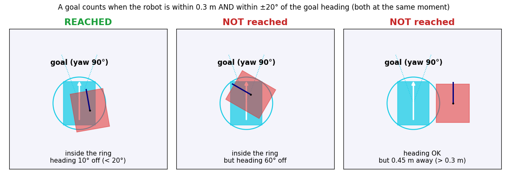

4. **Don't touch anything.** Robot centre closer than **0.28 m** to a wall = one collision.
5. **Time limit:** 20 minutes per run, starting when the robot first moves.

| | Goals | Map |
|---|---|---|
| **EASY** | 5 (the last one random) | Sparse blocks. Driving first along x, then along y, always works. |
| **HARD** | 4 (all random) | Walls and pillars. The straight line to the next goal is **always blocked**: you must plan a path. |

| Easy | Hard |
|------|------|
| 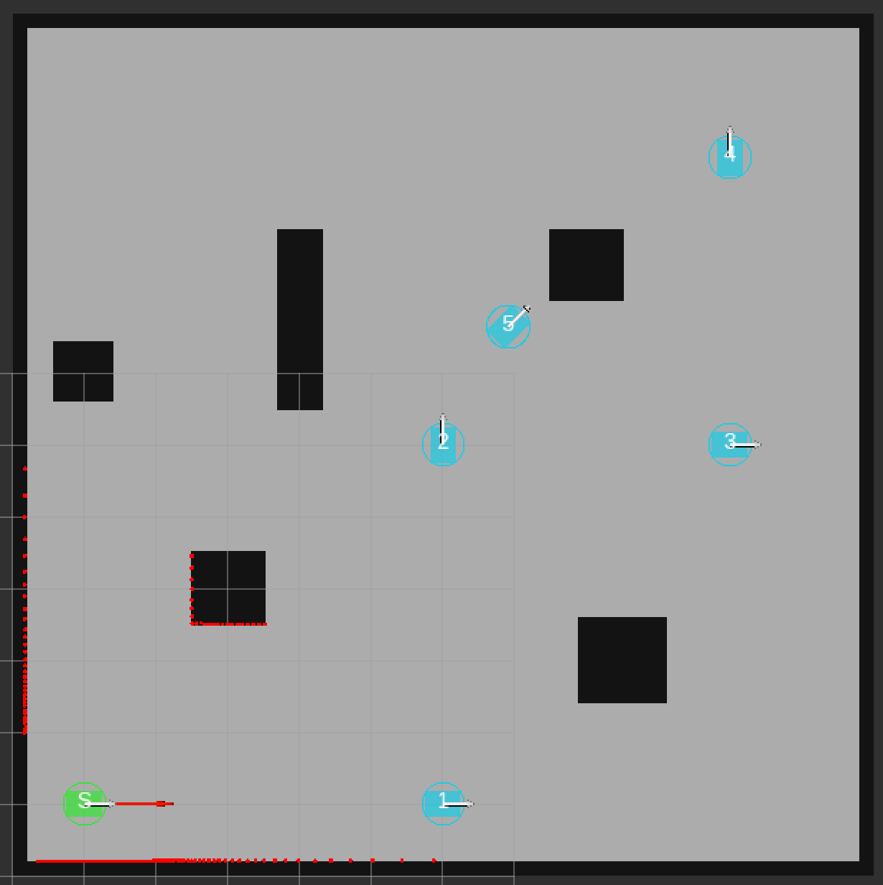 | 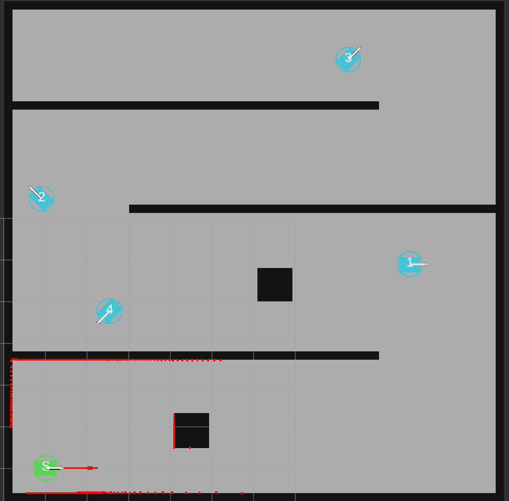 |
|  |  |

The markers are only drawings: the laser can't see them and they don't cause collisions.

## 2. Setup (once)

Everything runs in an **Ubuntu** Docker container. On **Ubuntu**, open a terminal (`Ctrl+Alt+T`) and go
to step 2. On **Windows**, you first need WSL, which gives you Ubuntu inside Windows.

### Step 1 (Windows only): install WSL and open an Ubuntu terminal

Press the Windows key, type `PowerShell` and open **Windows PowerShell**:

| Search | PowerShell |
|---|---|
| 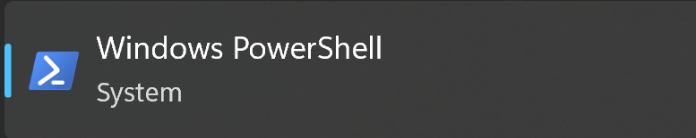 | 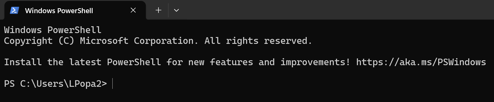 |

Install WSL with Ubuntu 22.04 (only once):
```bash
wsl --install -d Ubuntu-22.04
```

Restart if asked, and choose a Linux username and password.

**Opening an Ubuntu terminal** (you need one for everything that follows):

- open PowerShell and type `wsl`, **or**
- press the Windows key, type `WSL` and open the **WSL** app.

| `wsl` in PowerShell | WSL app | WSL terminal |
|---|---|---|
| 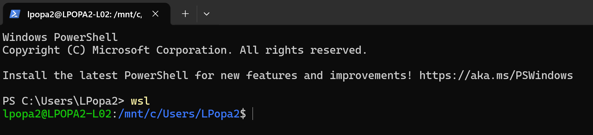 | 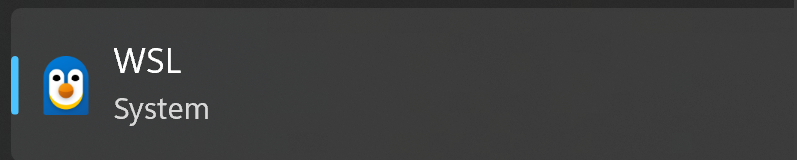 | 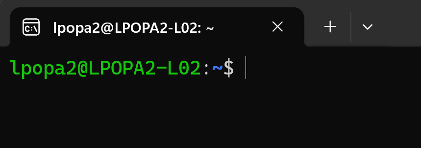 |

You're in Ubuntu when the prompt looks like `you@pc:~$`. A prompt like `PS C:\...>` is still Windows,
where none of the commands below work.

### Step 2: install Docker

In the Ubuntu terminal, update the list of packages (type your Linux password when asked; it stays invisible while you type):
```bash
sudo apt update
```

Install Docker, plus `xhost`, which lets the container open windows:
```bash
sudo apt install -y docker.io x11-xserver-utils
```

Allow your user to run `docker`:
```bash
sudo usermod -aG docker $USER
```

Apply that now, so you can use `docker` without `sudo`:
```bash
newgrp docker
```

### Step 3: download the image and create your container

Download the challenge image (1.8 GB):
```bash
docker pull laurentiupopa/coderun-ros2-wander:latest
```

Allow the container to open windows (Stage, RViz) on your screen:
```bash
xhost +local:root
```

Set your team number: replace `<team number>` with it (1-99). This keeps your robot separate from the
other teams' robots:
```bash
export ROS_DOMAIN_ID=<team number>    # e.g. export ROS_DOMAIN_ID=1
```

Create your container `coderun` and open a shell in it (only once):
```bash
docker run -it --name coderun --privileged --network=host -e DISPLAY=$DISPLAY -e ROS_DOMAIN_ID=$ROS_DOMAIN_ID -e ROS_LOCALHOST_ONLY=1 -v /tmp/.X11-unix:/tmp/.X11-unix:ro -w /root/ros_ws laurentiupopa/coderun-ros2-wander:latest bash
```

The prompt changes to `root@...:~/ros_ws#`: you're now **inside the container**.

$\color{red}{\textsf{Setup is done.}}$ Leave the container with $\color{red}{\texttt{Ctrl+D}}$: the prompt goes back to `you@pc:~$`. From now on you
start it as in [Working on your solution](#3-working-on-your-solution).

Do `docker run` **only once**. Your code lives inside this container: `docker rm coderun` deletes it.

## 3. Working on your solution

You need **two terminals**, both inside the container: $\color{red}{\textsf{Terminal 1}}$ and $\color{red}{\textsf{Terminal 2}}$.

**$\color{red}{\textsf{Terminal 1}}$: the arena and the judge.** Open an Ubuntu terminal.

Allow the container to open windows (Stage, RViz) on your screen:
```bash
xhost +local:root
```

Start your container and open a shell in it:
```bash
docker start -i coderun
```

Start the arena and the judge, **either** the EASY world:
```bash
ros2 launch coderun_challenge challenge.launch.py task:=easy
```

**or** the HARD world:
```bash
ros2 launch coderun_challenge challenge.launch.py task:=hard
```
Stage and RViz open (stop with `Ctrl+C`). Keep the Stage window open (a run without it is not valid).

**$\color{red}{\textsf{Terminal 2}}$: your code.** Open a **new** Ubuntu terminal (Windows: WSL app or PowerShell + `wsl`).

Open a second shell in the same, running container:
```bash
docker exec -it coderun bash
```

The prompt changes to `root@...:~/ros_ws#`: you're inside the container.

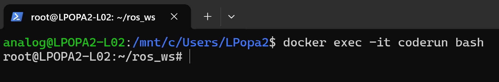

Edit, build and run your code here. The run command is **the same for EASY and HARD**: the world is
chosen in $\color{red}{\textsf{Terminal 1}}$, and your code decides how to plan (`USE_GRID_PATH` at the top of the file,
see [Your code](#4-your-code)).

**Python** (no build needed).

Open your Python code in the editor:
```bash
nano src/coderun_student/python/solution.py
```

In `nano`: change the code, **save with `Ctrl+S`**, **exit with `Ctrl+X`**.

Run your solution (stop it with `Ctrl+C`):
```bash
ros2 run coderun_student solution.py
```

**C++** (build again after every change).

Open your C++ code in the editor:
```bash
nano src/coderun_student/src/solution.cpp
```

In `nano`: change the code, **save with `Ctrl+S`**, **exit with `Ctrl+X`**.

Compile your code:
```bash
colcon build --packages-select coderun_student
```

Load the program you just compiled:
```bash
source install/setup.bash
```

Run your solution (stop it with `Ctrl+C`):
```bash
ros2 run coderun_student solution_cpp
```

When the run ends, $\color{red}{\textsf{Terminal 1}}$ prints `FINISHED ...` with your score. The details are in a file:
```bash
cat /tmp/coderun_result.json
```

**Always stop your old solution before you start a new run.** Two solutions running at the same time
fight over the robot, and it drives into walls.

**Stopping:**

| Keys | In | Does |
|------|----|------|
| `Ctrl+C` | $\color{red}{\textsf{Terminal 1}}$ | closes the simulation (Stage, RViz, judge) |
| `Ctrl+C` | $\color{red}{\textsf{Terminal 2}}$ | stops your solution node |
| `Ctrl+D` | either | leaves the container (prompt back to `you@pc:~$`) |

`Ctrl+D` in $\color{red}{\textsf{Terminal 1}}$ also stops the container. Your code is kept: `docker start -i coderun` again.

This is the **same judge** the staff use for grading, so your local score is your real score, minus
the time points (added at hand-in).

The goals change at every launch. To repeat exactly the same goals while debugging, add `seed:=42` (any
number) to the launch command. Test on several seeds: grading uses seeds you don't know.

## 4. Your code

The template is already written: it reads the topics, drives through a list of waypoints and publishes
the speeds. You complete the lines marked **TODO** (search the file for `TODO`). You don't need to know
ROS: the robot's pose is in `self.x, self.y, self.yaw` (C++: `x_, y_, yaw_`), the goals in
`self.goals` (`goals_`).

| | TODO | Where | What you decide |
|---|---|---|---|
| **EASY** | 1 | `plan_waypoints()` | The corner point between two goals (drive along x, then along y). |
| | 2-6 | `follow_waypoint()` | Turn and drive speeds, and when a goal's heading is close enough. |
| **HARD** | | top of the file | Set `USE_GRID_PATH = True`. |
| | 7 | `plan_waypoints()` | Turn the grid path into waypoints (cell centres). |
| | 8 | `grid_path()` | Write the breadth-first search yourself (the steps are in the comments). |

Do them in order and run after each one: after TODO 6, EASY is solved. HARD reuses the same driving
code. With `USE_GRID_PATH = True` your solution works in **both** worlds (the EASY corner points don't
work in HARD), so finish with that. Helpers you can use: `distance_to(x, y)`, `angle_to(x, y)`, `heading_error(yaw)`,
`world_to_cell(x, y)`, `cell_to_world(row, col)`, `free_neighbours(cell)`, `print_grid(path)`.
The settings at the top (`ARRIVED`, `FACING`) and your speeds are yours to tune: faster wins ties.

**HARD grid:** the template turns `/map` into a 24 × 24 grid of 0.5 m cells (`self.grid[row][col]`,
`True` = free, walls already made thicker by the robot's size). The lines between the centres of
neighbouring free cells keep clear of the walls.


**Breadth-first search (TODO 8)** finds the path with the fewest cells, like a wave spreading out from
the start:

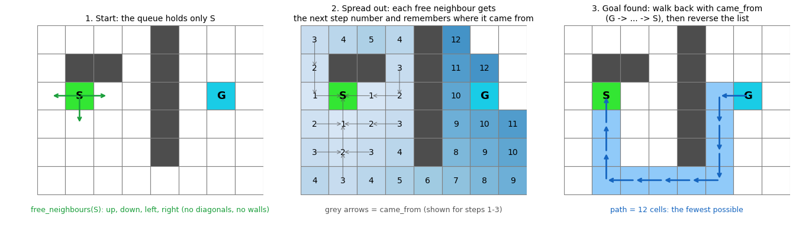

1. Put the start cell in a **queue**, and write down `came_from[start] = None`.
2. Take the **oldest** cell out of the queue. Look at its free neighbours (`free_neighbours(cell)`). For
   every one you haven't seen yet (not in `came_from`): write down where you came from
   (`came_from[next] = cell`) and add it to the **end** of the queue. Repeat until you take out the goal.
   Because the queue is first in, first out, all cells 1 step away come first, then all cells 2 steps
   away, and so on.
3. Walk back from the goal: `goal → came_from[goal] → … → start`. Reverse that list: that's your path.

Want more? Skip the cells where the path goes straight (fewer stops), or write your own planner on the
full `/map`.

| Topic | Type | In/out | Notes |
|-------|------|--------|-------|
| `/goals` | `geometry_msgs/PoseArray` | in | Goal poses, in order |
| `/map` | `nav_msgs/OccupancyGrid` | in | 0.04 m cells, `100` = wall, `0` = free, row 0 = lowest y |
| `/odom` | `nav_msgs/Odometry` | in | Robot pose, starts at (0, 0, 0) |
| `/base_scan` | `sensor_msgs/LaserScan` | in | 270°, 5 m, 1° steps, index 0 = rightmost ray |
| `/cmd_vel` | `geometry_msgs/Twist` | **out** | `linear.x` ≤ 1.0 m/s, `angular.z` ≤ 0.78 rad/s |

A team of three can split it: TODO 1 + testing, TODO 2-6, TODO 7-8.

## 5. Scoring

| Mode | Max | Baseline | Goals | Time points |
|------|-----|----------|-------|-------------|
| EASY | 110 | 10 | **18 per goal** (90), −5 per collision | 0.5 per minute left in the slot, max 10 |
| HARD | 220 | 20 | **45 per goal** (180), −10 per collision | 1 per minute left in the slot, max 20 |

- **One score per team, max 220.** Your hand-in is graded in EASY and in HARD, and the **better** of the
  two counts (they don't add up). HARD builds on EASY, so solve EASY first, then go for HARD.
- **Baseline:** for taking part.
- **Time points:** for every minute left in the slot when you hand in, but only if your goal points
  are **at least 50%** (≥ 45 EASY / ≥ 90 HARD).
- **Ties:** the faster robot run wins.

Example: EASY, 5/5 goals, 1 collision, handed in 12 min before the end: 10 + (90 − 5) + 0.5 × 12 = **101**.

## 6. Rules

- **No AI** (ChatGPT, Copilot, Claude, Gemini, …). Docs and web search are fine. Be ready to explain
  your code.
- **Hand in** your whole `coderun_student` folder by email (see [Hand in](#7-hand-in)). Write your code in
  `python/solution.py` **or** `src/solution.cpp` (extra files next to it are fine).
- Use only `/goals`, `/map`, `/odom`, `/base_scan` and `/cmd_vel`. Never touch `/ground_truth`.
- The staff grade your solution on their machine, on seeds you don't know, and average the runs.

## 7. Hand in

**1. Copy your code out of the container.** In an Ubuntu terminal **outside** the container (prompt
`you@pc:~$`, not `root@...`):

Delete the old copy, if there is one:
```bash
rm -rf ~/coderun_student
```

Copy the `coderun_student` folder out of the container into your Linux home:
```bash
docker cp coderun:/root/ros_ws/src/coderun_student ~/
```
This puts the whole `coderun_student` folder (Python and C++) in your Linux home. Do it often as a
backup too.

**2. Find the folder.** Windows: open File Explorer and paste this in the address bar:
```
\\wsl.localhost\Ubuntu-22.04\home
```
Then open your Linux username → `coderun_student`. Or click your way there: **Linux** → **Ubuntu-22.04**
→ `home`. Ubuntu: it's in your home folder.

| Address bar | Sidebar |
|---|---|
| 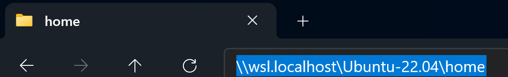 | 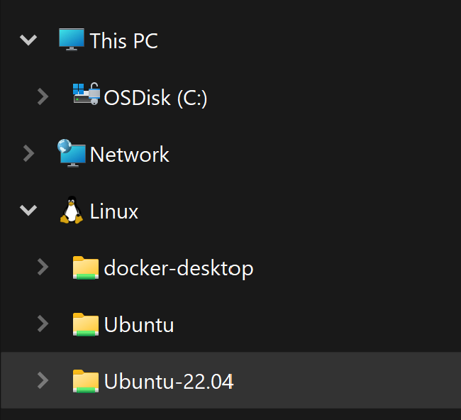 |

**3. Zip and email it.** Right-click `coderun_student` → *Compress to ZIP file*, and send the zip to
**ioanlaurentiupopa16@gmail.com** with the subject **`Coderun ROS2 wander - <TeamName>`**. In the
email, say whether you used **Python** or **C++**. The time of the email is your hand-in time.

## Troubleshooting

| Problem | Fix |
|---------|-----|
| `docker: permission denied` | Run `newgrp docker` (step 2), or close the terminal and open a new one. |
| `container name "/coderun" is already in use` | The container exists: use `docker start -i coderun`, not `docker run`. |
| `container ... is not running` | `docker start coderun`, then `docker exec -it coderun bash` again. |
| No Stage / RViz window, X server error | `xhost +local:root` outside the container, then restart it. |
| Robot doesn't react to your node | Both terminals must be inside the same container (`docker exec`). |
| Robot is stuck against a wall, or drives into a wall / jerks right after the start | Probably an old solution is still running. Stop every solution with `Ctrl+C` (check every terminal), close the world with `Ctrl+C` in Terminal 1, start the world again, then run your solution again. |
| `docker pull` fails | Build the image yourself (see below). |

If `docker pull` fails, build the image yourself.

Download the source code:
```bash
git clone https://github.com/laurent-19/coderun-ros2-wander.git
```

Go into its folder:
```bash
cd coderun-ros2-wander
```

Build the image (this takes a while):
```bash
docker build -t laurentiupopa/coderun-ros2-wander:latest .
```
