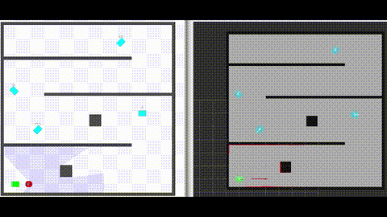
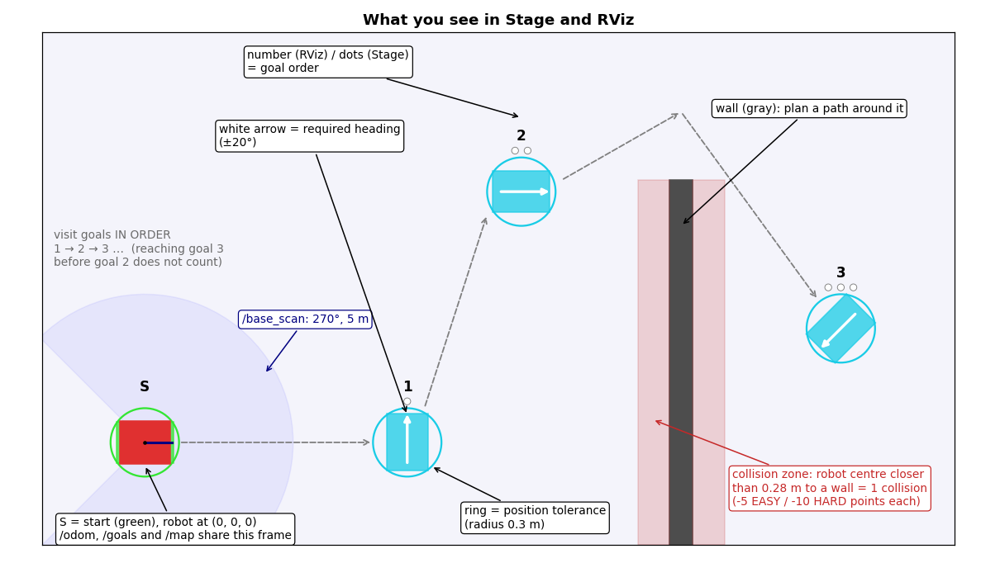
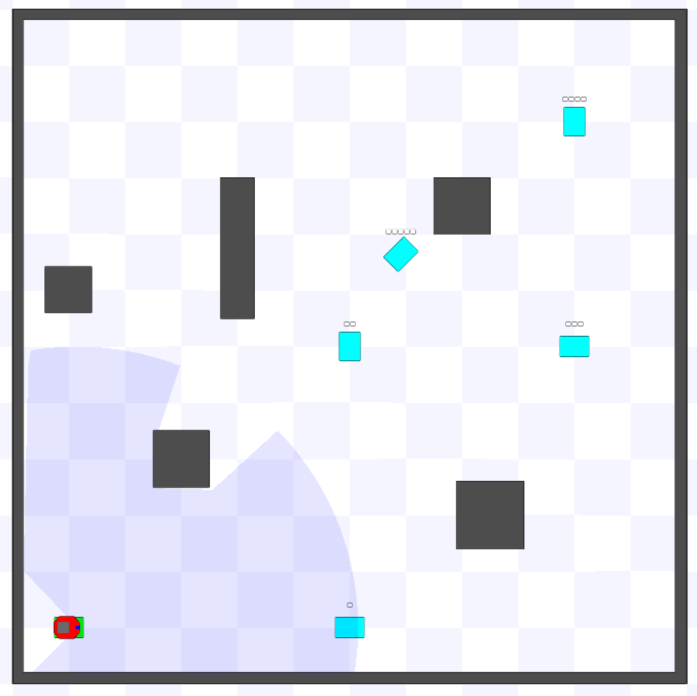
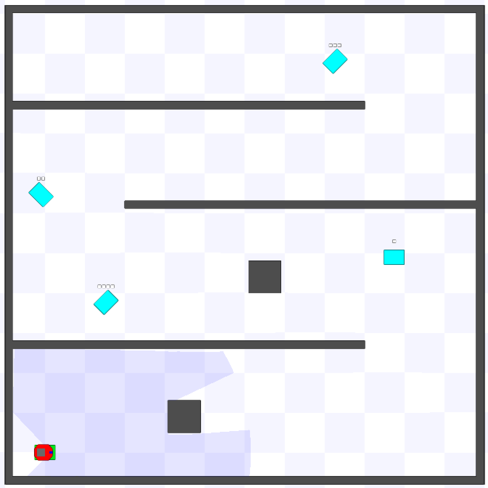
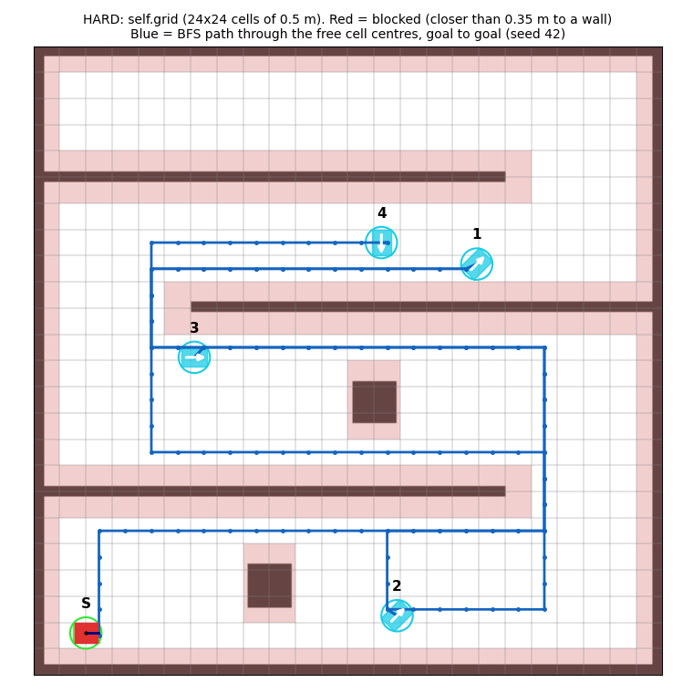

# CodeRun 2026 - Path Planning Challenge

A delivery robot has just been installed in a warehouse. Each morning it gets a list of stations, which
it has to visit in order. At every station it must stop, facing the right way, so it can dock. Shelves
and walls are in the way, the station list changes every day, and the faster the robot finishes its
round, the better. Your job is to write its brain.

You control a differential-drive robot in the Stage simulator (ROS 2 Humble). Drive it through a list
of **goal poses** (x, y, heading), **in order**, **without touching anything**, as fast as you can.



## 1. Requirements



1. **Read the goals at runtime** from `/goals`. They are random at every launch: in EASY the last one
   is random, in HARD all of them are. Hard-coded positions will not work.
2. **Visit the goals in order** (1 → 2 → 3 …). Only the *next* goal counts. Driving through a later one
   first does nothing.
3. **A goal is reached** when the robot is **within 0.3 m** of it **and** its heading is **within ±20°**
   of the goal heading at the same moment. The white arrow in the marker shows that heading.

   

4. **Don't touch anything.** If the robot centre comes closer than **0.28 m** to a wall or obstacle,
   that counts as one collision. The next one can only count after the robot has moved away again.
5. **Time limit:** 20 minutes of driving per run. The clock starts when the robot first moves.

| | Goals | Map |
|---|---|---|
| **EASY** | 5 (the last one random) | Sparse blocks. Driving first along x, then along y from goal to goal always works. |
| **HARD** | 4 (all random) | Staggered walls and pillars. The straight line to the next goal is **always blocked**, so you have to plan a path. The template gives you a small grid for that (see below). |

| Easy Mode | Hard Mode |
|-----------|-----------|
|  |  |
|  |  |

The markers are only visual. The laser can't see them and they don't cause collisions.

### Suggested approach

1. **EASY: a go-to-pose controller.** Turn on the spot towards the next waypoint, drive to it, and at
   a goal turn to the goal heading. With x-then-y waypoints, this alone solves EASY.
2. **HARD: the same controller plus a search on a grid.** The template turns `/map` into
   `self.grid[row][col]`, a 24 × 24 grid of 0.5 m cells. `True` means free, and the walls are already
   inflated by the robot's size.
   - Search from the robot's cell to the goal's cell, e.g. with **breadth-first search over the 4
     neighbours**: about 20 lines of Python.
   - Drive through the centres of the cells on the path. The straight lines between neighbouring free
     cell centres keep clear of the walls.
   - `world_to_cell(x, y)` and `cell_to_world(row, col)` convert between metres and cells.
     `print_grid(path)` draws the grid and your path in the terminal.

   

   You can skip the cells where the path goes straight on, so the robot makes fewer stops. You can also
   use your own planner on the full `/map`; anything that reaches the goals without collisions counts.

A team of three can split the work: one person on the controller, one on the search, one testing on
different seeds (`seed:=…`).

## 2. Input / output

Your node: `~/ros_ws/src/coderun_student/coderun_student/solution.py` (the template subscribes to
everything for you).

| Topic | Type | Direction | Notes |
|-------|------|-----------|-------|
| `/goals` | `geometry_msgs/PoseArray` | in | Goal poses in order. Latched: subscribe with transient-local QoS (see the template) |
| `/map` | `nav_msgs/OccupancyGrid` | in | 0.04 m cells, `100` = wall, `0` = free, row 0 = lowest y. Latched |
| `/odom` | `nav_msgs/Odometry` | in | Robot pose estimate, starts at (0, 0, 0) |
| `/base_scan` | `sensor_msgs/LaserScan` | in | 270°, 5 m, 1° steps. Index 0 = rightmost ray |
| `/cmd_vel` | `geometry_msgs/Twist` | **out** | `linear.x` ≤ 1.0 m/s, `angular.z` ≤ 0.78 rad/s |

`/goals`, `/map` and `/odom` are all in the same frame, with the robot starting at its origin.
`/ground_truth` belongs to the judge. Don't subscribe to it and don't publish on it (see Rules).

## 3. Scoring

| Mode | Max | Baseline | Requirements | Time points |
|------|-----|----------|--------------|-------------|
| EASY | 110 | 10 | 90 = **18 per goal**, −5 per collision | 0.5 per minute left in the slot, max 10 |
| HARD | 220 | 20 | 180 = **45 per goal**, −10 per collision | 1 per minute left in the slot, max 20 |

- **Baseline:** you get it just for taking part.
- **Requirements:** points per goal reached, minus the collision penalty (never below 0).
- **Time points:** for every minute left in the CodeRun slot when you hand in your solution. You only
  get them if your requirement points are **at least 50%** (≥ 45 EASY / ≥ 90 HARD).
- **Ties** are broken by the robot run time (`elapsed_s`).

Examples:

| Mode | Run | Hand-in | Score |
|------|-----|---------|-------|
| EASY | 5/5 goals, 1 collision | 12 min before the end | 10 + (90 − 5) + 0.5 × 12 = **101** |
| HARD | 3/4 goals, 0 collisions | 25 min before the end | 20 + 135 + min(20, 25) = **175** |
| HARD | 1/4 goals | 40 min before the end | 20 + 45 + 0 (45 < 90) = **65** |

When you run it yourself, the judge writes `/tmp/coderun_result.json`: goals reached, the time of each
goal, collisions, seed, score.

## 4. Rules

- **AI is forbidden.** No AI assistants or code generators (ChatGPT, Copilot, Claude, Gemini, …) during
  the challenge. Documentation, ROS docs and web search are allowed. The graders may ask you to explain
  your code.
- **What you hand in:** your `solution.py` (plus any extra Python files it imports).
- **Official grading:** the company staff run your solution on their own machine, on official seeds you
  don't know in advance, with the same judge. The result is the average over those runs. A run where
  anything other than the simulator publishes the judge's ground truth is invalid.
- Use only `/goals`, `/map`, `/odom`, `/base_scan` and `/cmd_vel`.

## 5. Setup (do this BEFORE the event)

The image is about 1.8 GB. Pull it and run the demo once at home: the venue Wi-Fi is shared.

Everything below runs inside the container, which is built on **Ubuntu** — Docker and ROS 2 need a
Linux system under them. **Windows users need WSL (Windows Subsystem for Linux)** to get that Ubuntu
system; **if you're already on Ubuntu/Linux, skip straight to "Install Docker Engine" below.**

### Windows: install WSL

In PowerShell (as Administrator):
```bash
wsl --install -d Ubuntu-22.04
```
Restart your PC if asked, then pick a username/password for the new Ubuntu when prompted.

From now on, **every time you come back to this** — new PowerShell window, after a reboot, on the day
of the event — open a WSL shell first. Plain PowerShell is Windows, not Linux: none of the `docker`/
`ros2` commands in this README work there.
```bash
wsl
```
You should land on a Linux-style prompt (e.g. `you@yourpc:~$`) before going any further. Run every
command below — including `docker ...` — inside this WSL shell, not in PowerShell.

### Install Docker Engine

Inside WSL (or on native Ubuntu):
```bash
sudo apt update && sudo apt install -y docker.io x11-xserver-utils
```

```bash
sudo usermod -aG docker $USER
```

Log out and back in (or `newgrp docker`).

### Start the container

```bash
docker pull laurentiupopa/coderun-ros2-wander:latest
```

```bash
xhost +local:root
```

Pick a **unique** `ROS_DOMAIN_ID` for your team (1–99, e.g. your team number). Together with
`ROS_LOCALHOST_ONLY=1`, this stops your robot from hearing other teams' robots on the same network.
```bash
export ROS_DOMAIN_ID=<your team number>
```

```bash
docker run -it --name coderun --privileged --network=host -e DISPLAY=$DISPLAY -e ROS_DOMAIN_ID=$ROS_DOMAIN_ID -e ROS_LOCALHOST_ONLY=1 -v /tmp/.X11-unix:/tmp/.X11-unix:ro -w /root/ros_ws laurentiupopa/coderun-ros2-wander:latest bash
```

### Run

**Terminal 1**: arena + judge:
```bash
ros2 launch coderun_challenge challenge.launch.py task:=easy team:=MyTeam
```

**Terminal 2**: open a second shell in the same container and start your solution:
```bash
docker exec -it coderun bash
```

```bash
ros2 run coderun_student solution
```

The workspace is built with `--symlink-install`, so edits to `solution.py` work without a rebuild.
Useful launch options: `task:=hard`, `seed:=42` (repeat the same goals), `rviz:=false`.
Keep the Stage window open: with `gui:=false` the simulator runs faster than real time and the run is
not valid.

### Container management

```bash
docker stop coderun      # pause
docker start -i coderun  # resume
docker rm coderun        # delete
```

## Troubleshooting

- **`xhost` not found:** `sudo apt install x11-xserver-utils`
- **X server error:** `xhost +local:root` and `export DISPLAY=:0`
- **Container name exists:** `docker rm coderun`
- **`docker exec` says "container ... is not running":** it was stopped (e.g. after a reboot). Start
  it first with `docker start coderun`, then run `docker exec -it coderun bash` again.
- **Topics not visible:** use the same `ROS_DOMAIN_ID` everywhere. `docker exec` shells inherit the
  container's environment.
- **Build from source** (if the pull fails):
  ```bash
  git clone https://github.com/laurent-19/coderun-ros2-wander.git
  cd coderun-ros2-wander
  docker build -t laurentiupopa/coderun-ros2-wander:latest .
  ```
